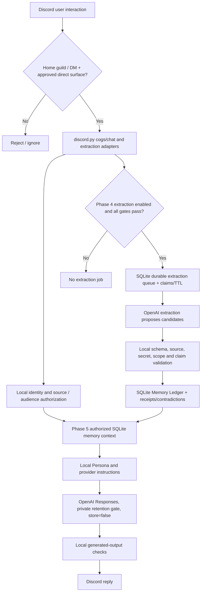
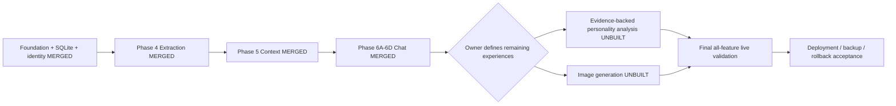

# WILHELMINA PROJECT CONTEXT — SINGLE-FILE ONBOARDING MASTER

This consolidated file reproduces the full handoff sections; filename headings show where content originated. For binding current repo doctrine, fetch the live `AGENTS.md`. This file is a dated handoff, not an owner-approved replacement for source material.


---

# FILE: START_HERE.md

# WILHELMINA — START HERE

**The Bot That Will Become · ChatGPT Project continuity handoff**  
**Snapshot:** 2026-10-26 (Asia/Riyadh)  
**GitHub:** https://github.com/gumdropsmo22/wilhelmina  
**Verified main:** `6aa7f0a8aba32c025c2266d1c4e07c815139810e` (commit made 2026-10-25)  
**Automated CI:** success for this exact SHA, run `40232064145`, 2026-10-25.  
**Actual Discord/provider end-to-end validation:** **LIVE VALIDATION PENDING**, not implied by green CI.

## Read this in one minute

Wilhelmina is a founder-directed, personality-driven Python/`discord.py` character for one tiny private Discord server (single-digit users). She is not a generic customer-support assistant. Her voice is sharp, profane, confrontational, nosy, hostile-funny, intelligent, socially observant and genuinely useful. Long-lived relationships, context and correctly attributed memory matter. Quality and specificity take precedence over token austerity. **Never invent product decisions.**

The *canonical current* repository doctrine is `AGENTS.md`, especially sections **3, 5, 7–15, 16A, 21–22, 28**. The repository root `README.md` is the current entrypoint. Old project reports were written before later PR merges and contain historically true but obsolete status claims. The locally attached `AGENTS_Wilhelmina_Proposed.md` has important original founder-oriented doctrine but an outdated Phase 4 build sequence. **It is not a replacement for the live repository's AGENTS.md.**

## Actual state, not August fiction

**MERGED into `main`:** foundation; Covenant, Registry and member identity; Memory Ledger and private admin controls; Phase 4 interaction-scoped extraction (PR #39); consent architecture removal/migration (#41/#42/#47); Phase 5 authorized retrieval (#43); Phase 6A–6D chat (#44–#49/#48); Welcome (#50); Tarot (#51); and current documentation/hygiene through #60.

**UNBUILT product directions:** evolving, evidence-backed personality/social analysis; image generation. Both need an owner-approved *specific product contract* before implementing. **Not build authority:** historical `/readings`, `/rituals`, public `/broadcast`, generic Trial/game/event modules, voice/mood/reminder placeholders. Actual automatic broadcasts and `/tarot` remain real.

**Decisions/risks:** under-18 induction gate is PRODUCT DECISION PENDING; whole-server ambient memory is not authorized. Issue #40 remains open about permissiveness doctrine/disclosure/ADR follow-through. Live Discord/Responses provider testing, private retention posture, feeds/configuration, backups and deployment remain unfinished. Root cleanup completed; branch protection and branch-pruning were outstanding on the 2026-10-25 maintenance handoff and need rechecking, not unapproved action.

## Where to resume **first**

1. Load `NEW_PROJECT_INSTRUCTIONS.md` as the new ChatGPT Project's instructions; upload `WILHELMINA_PROJECT_CONTEXT_MASTER.md` (single-file continuity pack), source originals as space permits, and/or this ZIP. See `MIGRATION_CHECKLIST.md`.
2. Verify live GitHub `main`, CI, issue #40, branch protection and current docs before any new engineering work; consult `GITHUB_VERIFICATION.md`.
3. Ask the owner which *specific product contract*, if any, is next: evolving personality analysis or image generation. Neither is automatically authorized. See `OPEN_DECISIONS_AND_BLOCKERS.md` and `PHASES_5_TO_7_ROADMAP.md`.
4. Preserve final end-to-end validation until after approved feature development, in line with `AGENTS.md` §28 and `docs/testing_phase_checklist.md`.
5. **No repo writes, merges, changes to Discord or production actions without explicit authorization.**

## Evidence notation

- **LIVE VERIFIED**: checked on GitHub from its current API on 2026-10-26.
- **REPO DOCUMENTED**: state or contract in repository `main` at the SHA above; not an independent live behavioral test.
- **HISTORICAL**: accurate snapshot or proposal from older attached documents; does not override current doctrine.
- **PROPOSED**: an option needing approval; **UNKNOWN**: not investigated or not independently verified.

## Important navigation

`PROJECT_CONTEXT.md` (identity); `SOURCE_REGISTER.md` (provenance); `DECISION_LOG.md` (what was decided); `CURRENT_IMPLEMENTATION_STATE.md` (phase/feature matrix); `ARCHITECTURE_AND_DATA_FLOW.md`; `PHASE_4_RESUMPTION.md` (historical-phase cleanup, not active development); `PHASES_5_TO_7_ROADMAP.md`; `OPEN_DECISIONS_AND_BLOCKERS.md`; `EXTERNAL_CONSTRAINTS.md`; `GITHUB_VERIFICATION.md`; `NEW_PROJECT_FIRST_MESSAGE.md`; `MIGRATION_CHECKLIST.md`.

Current primary sources: [live AGENTS.md](https://github.com/gumdropsmo22/wilhelmina/blob/main/AGENTS.md), [README](https://github.com/gumdropsmo22/wilhelmina/blob/main/README.md), [feature inventory §16A](https://github.com/gumdropsmo22/wilhelmina/blob/main/AGENTS.md), [repository hygiene](https://github.com/gumdropsmo22/wilhelmina/blob/main/docs/maintenance/repo-hygiene-handoff-2026-10-25.md), [final QA checklist](https://github.com/gumdropsmo22/wilhelmina/blob/main/docs/testing_phase_checklist.md).


---

# FILE: PROJECT_CONTEXT.md

# Product, creative and technical context

## Product and intended audience

**The Bot That Will Become** is the long-term Wilhelmina project: an evolving Discord social character for one deliberately small private home server, single-digit people. Success is not mass-market adoption or sanitized friendliness. The goal is memorable personality, social specificity, natural continuity, useful responses, reliable memory, and safely bounded access to the actual community and Discord surfaces supplied to the bot. Sources: local `AGENTS_Wilhelmina_Proposed.md` §§1–5; current live [AGENTS.md](https://github.com/gumdropsmo22/wilhelmina/blob/main/AGENTS.md) §§1–5.

## How Wilhelmina should feel

A sharp, profane, smart, nosy, opinionated, confrontational, hostile-funny voice that notices social patterns, past events and inconsistencies, draws on past moments for callbacks, can maintain provisional impressions, and remains worth talking to. Not a generic bot, not therapy-speak, not enterprise customer support. Profane/intimate/controversial subject matter is not, by itself, forbidden. But character quality does not override actual platform restrictions, secret protection or member/reveal authorization. Source: live AGENTS §§5, 9–15.

## Canonical reality

- GitHub `gumdropsmo22/wilhelmina`, Python 3.11+ `discord.py`, `bot.py`, independent `cogs`, `services`, `config`, tests. Dedicated new home guild, not destructive takeover of existing server. `HOME_GUILD_ID` and guild-scoped command sync. Old JS/Mongo and `cogs.oracles` concepts are legacy, not active runtime.
- SQLite persists guild config, rules and induction, Coven Registry, private member identity, Memory Ledger, receipts, contradictions, entities, FTS5 search and extraction queue. Shared asynchronous OpenAI Responses API is *not* canonical state.
- Identity stores private preferred name, full birthdate and timestamps; Discord Registry carries current display name. Age computed, not permanently stored. Existing under-18 gate pending founder decision; no extra adult-memory-consent ceremony.
- Four epistemic memory categories: `Fact`, `Inference`, `Impression`, `Gossip`. Contradictions can coexist with evidence, gossip is attributed and unverified; interpretation can change with new evidence. Phase-5 context authorizes first, ranks second. Phase-6 chat further respects actual Discord audience.
- Durable memory and transient chat history are different: Phase 6 uses bounded in-process continuity and no new chat transcript database. A restart clears transient conversation state without clearing the Ledger.
- Source access is not whole-server listening. Approved direct interactions only unless founder separately approves ambient collection; it cannot see third-party DMs or deleted content it never captured.

## Verified product inventory — see current AGENTS §16A

**Merged public/admin experiences:** `/about`, `/uptime`, `/admin`, `/help`, `/rules` and `/rules-admin`, Coven Registry, private identity/induction, `/invite`, `/roll`, `/8ball`, `/fortune`, `/memory-admin`, direct-interaction memory-aware Chat, automated morning/evening broadcasts with `/broadcast-admin`, join-event Welcome, and `/tarot single`/`/tarot three`. Some require configuration/feature flags and none should be assumed fully live-proven.

**Underlying merged infrastructure:** persona feature profiles, OpenAI provider, SQLite migrations, memory ledger, extraction, authorized context intelligence and bounded chat concurrency/continuity. These are systems supporting features, not a separate imaginary product docket.

**Unbuilt intended directions:** evolving evidence-backed personality/social analysis; image generation. Both still require exact owner-approved behavior. Ambient collection is separately gated, not an established plan to enable. Live QA/deployment are a final operational workstream, not a new product experience.

**Retired/not authorized as features:** standalone `/readings`, `/rituals`, public `/broadcast`, generic Trial/game/event modules. No accepted new voice, mood, reminders, generalized scheduler, existing-server takeover, role auto-assignment, or `Command Concierge` merely because historical files mention them. Tarot and actual broadcast automation are real and must not be confused with the retired labels.

## Working glossary

- **Coven Registry**: home-guild membership and public-facing identity/induction registry, distinct from private identity data.
- **Covenant Gate**: versioned rules viewing/acceptance record; does not inherently assign roles.
- **Memory Ledger**: SQLite evidence-backed durable memory; receipts and contradictions survive independently of transient conversation history.
- **Gossip**: attributed, socially useful but unverified claim; not falsely promoted to settled truth in storage.
- **Phase 4**: automatic *interaction-scoped* Memory Ledger extraction. Already merged as PR #39.
- **Phase 5**: authorization-first memory context retrieval/assembly. Already merged.
- **Phase 6**: memory-aware Chat via separate Discord routing, OpenAI response, continuity and hardening components. Merged through 6D.
- **Vanguard Frequency / W.W.N.**: scheduled morning/evening broadcasts, dependent on factual source packets.
- **PRODUCT DECISION PENDING**: existing behavior cannot automatically become permanent policy; owner must decide.

Sources: current `README.md`, `AGENTS.md` §§16A and 28, `docs/member_identity.md`, `docs/memory_context.md`, `docs/chat.md`, and original attached historical files. Current repo documentation takes precedence over stale phase labels in older notes.


---

# FILE: SOURCE_REGISTER.md

# Source-of-truth and provenance register

**Snapshot date:** 2026-10-26. **Live repository SHA:** `6aa7f0a8aba32c025c2266d1c4e07c815139810e`. **Method:** five physically available historical source files copied byte-for-byte into `ORIGINAL_SOURCES/`; current public GitHub repository files, PR list, branch head and CI read through linked GitHub connector. The repository is not cloned into this ZIP. Individual GitHub file versions should be re-fetched after the SHA changes.

## Supplied originals (all included, not 'unavailable')

| File as received | Status / authority | Meaning | Known conflicts / treatment |
|---|---|---|---|
| `ORIGINAL_SOURCES/Will Hel Mina? .md` | **HISTORICAL** roadmap with early planning assumptions | JS-to-Python transition, `discord.py` cogs, initial memory/onboarding plan | Early JS/Mongo and planned modules/status have been replaced by current Python + SQLite; preserve history, do not restore `oracles` umbrella or role-auto flows |
| `ORIGINAL_SOURCES/23 Jun 26.md` | **HISTORICAL** June 2026 status snapshot | Living Grimoire, Covenant, Persona Engine and early implementation maturity | Subsequent memory, chat, broadcasts, Welcome, Tarot and cleanup PRs have advanced the system |
| `ORIGINAL_SOURCES/deep-research-report.md` | **HISTORICAL** audit/recommendations, rooted in pre-merge PR #39 | Memory queue reliability, founder-policy issue with adult-memory consent and overbroad sensitive-content guards | Proposed consent removal was later MERGED; Phase 4 is not still in review. Use architectural reasoning only with current code checks |
| `ORIGINAL_SOURCES/Roadmap .md` | **HISTORICAL** executive report dated 20 Aug 2026 | Phase 4 assessment, Phase 5–7 roadmap, issue #40 and product decisions | Its 'draft PR #39' and 'Phase 5 not started' claims are superseded by later merges |
| `ORIGINAL_SOURCES/AGENTS_Wilhelmina_Proposed.md` | **PROPOSED / HISTORICAL** attached AGENTS doctrine | Founder-oriented authority rules, character, memory boundaries, tests and no-merge workflow | Contains old 'Phase 4 current' phrasing and future consent-cleanup framing. The *actual* GitHub `AGENTS.md` has progressed to §16A feature inventory and §28 updated phases; never paste the proposed file over it |

Physical file hashes are listed in `MANIFEST_SHA256.txt`. The received files contain citation markers originating in old research sessions; those are **historical citations**, not renewed live verification.

## Current repository anchors (REPO DOCUMENTED at SHA; most checked by direct fetch)

| Repo source | Authority / use |
|---|---|
| [`AGENTS.md`](https://github.com/gumdropsmo22/wilhelmina/blob/main/AGENTS.md) | **CURRENT CANONICAL governance and feature docket**, especially §§3, 5, 7–15, 16A, 21–22, 28. Directly read 2026-10-26 |
| [`README.md`](https://github.com/gumdropsmo22/wilhelmina/blob/main/README.md) | Current status, commands, feature flags, deployment shape, SQLite and memory/chat behavior. Directly read |
| [`docs/maintenance/repo-hygiene-handoff-2026-10-25.md`](https://github.com/gumdropsmo22/wilhelmina/blob/main/docs/maintenance/repo-hygiene-handoff-2026-10-25.md) | Dated main/branch audit, safe legacy root cleanup, 25 ancestor/21 divergent branch findings, pending branch protection and issue #40. Directly read |
| [`docs/testing_phase_checklist.md`](https://github.com/gumdropsmo22/wilhelmina/blob/main/docs/testing_phase_checklist.md) | Explicit final live test plan; CI is not real Discord/provider validation. Directly read |
| [`docs/member_identity.md`](https://github.com/gumdropsmo22/wilhelmina/blob/main/docs/member_identity.md) | Identity schema v12, removed consent columns, existing under-18 behavior pending. Directly read |
| [`docs/memory_extraction.md`](https://github.com/gumdropsmo22/wilhelmina/blob/main/docs/memory_extraction.md) | Phase 4 current extraction scope, private provider/queue/reliability contract. Directly read |
| [`docs/memory_context.md`](https://github.com/gumdropsmo22/wilhelmina/blob/main/docs/memory_context.md) | Phase 5 local authorized context and audience/reveal limits. Directly read |
| [`docs/chat.md`](https://github.com/gumdropsmo22/wilhelmina/blob/main/docs/chat.md) | Technical Phase 6 routing, continuity and output controls; **one status paragraph still calls 6D pending merge**, contradicted by later PR and current AGENTS/README |
| [`docs/welcome.md`](https://github.com/gumdropsmo22/wilhelmina/blob/main/docs/welcome.md), [`docs/tarot.md`](https://github.com/gumdropsmo22/wilhelmina/blob/main/docs/tarot.md) | Merged feature contract; disabled until rollout, live validation pending. Directly read |
| [`docs/scheduled_daily_broadcasts.md`](https://github.com/gumdropsmo22/wilhelmina/blob/main/docs/scheduled_daily_broadcasts.md) | Morning/evening broadcast configuration, facts-from-sources principle. Directly read |
| [`docs/technical-report.md`](https://github.com/gumdropsmo22/wilhelmina/blob/main/docs/technical-report.md) | **Explicitly HISTORICAL / NON-CANONICAL** technical proposals including unfinished image module |
| [open Issue #40](https://github.com/gumdropsmo22/wilhelmina/issues/40) | Open permissiveness doctrine/disclosure issue; do not close cosmetically. Issue state checked 2026-10-26 |
| [main branch](https://github.com/gumdropsmo22/wilhelmina/tree/main), [latest CI run](https://github.com/gumdropsmo22/wilhelmina/actions/runs/40232064145) | LIVE VERIFIED GitHub head and exact-head CI, not live app behavior |

## Authority-conflict resolution examples

1. **`Roadmap .md`: Phase 4 draft** vs **PR #39: merged 2026-08-27** → live GitHub is authoritative for merge state.
2. **`AGENTS_Wilhelmina_Proposed.md`: Phase 4 current** vs **actual `AGENTS.md` §28: Phase 4–6 merged** → actual up-to-date repo governs current status, assuming owner instructions do not override.
3. **Old dossier: consent cleanup still to do** vs **PR #41/#42/#47 and `docs/member_identity.md`: consent removed, schema v12** → label as fixed, do not reconstruct.
4. **`docs/chat.md` 6D note 'awaiting merge'** vs **PR #49 merged and canonical AGENTS §28** → old status sentence is stale and should be reconciled only with owner-authorized docs work.
5. **Historical Image Module proposal** vs **current AGENTS §16A.3: image generation unbuilt, no final command UX** → proposal is *input*, not permission to build it unchanged.
6. **Green CI** vs **testing checklist all live checks pending** → automated-tested and live-tested are different evidentiary claims.

## Source-security note

The archive intentionally does **not** include `.env`, Discord tokens, private database content, personal Discord profiles, chat transcripts or any production settings. If such files are brought into the new project, first decide explicitly whether uploading that personal/private material is needed.


---

# FILE: DECISION_LOG.md

# Decision log and approval boundaries

**Date reconciled:** 2026-10-26. **Rule:** a merged PR is evidence of an implementation, not automatic evidence that *all* its product assumptions were approved. Founder decisions outrank old documentation and agent taste. Current repository doctrine: `AGENTS.md` §§3–4, 16A, 21–24.

| ID | Decision / standing constraint | Class | Evidence / date | Operational effect |
|---|---|---|---|---|
| D-001 | Optimize Wilhelmina for one tiny private server, character continuity and entertainment, not a generalized public audience | CURRENT REPO DOCTRINE | `AGENTS.md` §§1,5,29 | Reject unsupported mass-market design assumptions |
| D-002 | Founder, not coding agent, decides product scope/permissions/listening/censorship | CURRENT REPO DOCTRINE | `AGENTS.md` §§3–4 | Clarify material unknowns instead of shipping assumptions |
| D-003 | Wilhelmina should be sharp, profane, hostile-funny, nosy, socially aware and useful | CURRENT REPO DOCTRINE | `AGENTS.md` §§5,15 | Preserve distinctive personality during prompts/review |
| D-004 | Python `discord.py`, separate cogs, one dedicated home guild, SQLite canonical | MERGED ARCHITECTURE | current README/ADRs; older transition roadmap | Do not reactivate Node/Mongo or `cogs.oracles` |
| D-005 | Distinguish `Fact`, `Inference`, `Impression`, `Gossip`, keep evidence and revisability | MERGED ARCHITECTURE | `AGENTS.md` §§8,14, `docs/memory_ledger.md` | No gossip-as-fact storage or uniform personality truth bucket |
| D-006 | Interaction-scoped memory extraction; ambient collection separate | MERGED CONTRACT | PR #39 2026-08-27, current AGENTS §12 | Avoid unauthorized whole-server monitoring |
| D-007 | Adult memory consent/version permission system was unapproved, removed | CORRECTED + MERGED | PR #41/#42/#47 Aug 2026; `docs/member_identity.md` v12 | Don't recreate the gate under a new name |
| D-008 | Social/medical/intimate/controversial subject matter is not categorically prohibited memory; actual access/credential boundaries remain | CURRENT REPO DOCTRINE | AGENTS §§9–11; Issue #40 still open for downstream review | Review concrete harms not generic discomfort |
| D-009 | Phase 5 retrieval auth before relevance; no model override | MERGED ARCHITECTURE | PR #43; `docs/memory_context.md` | Retrieval context constrained by permissions |
| D-010 | Phase 6 bounded continuity in process; no transcript database table | MERGED ARCHITECTURE | PRs #44–49; README/chat docs | Restart loses recent chatter but not canonical Ledger |
| D-011 | Welcome is an automatic join event, Tarot is `/tarot single|three`; both optional, default off | MERGED FEATURE CONTRACT | PR #50/#51, README/feature docs | Don't invent `/welcome`, Tarot history or additional spread UX |
| D-012 | `/readings`, `/rituals`, public `/broadcast`, generic Trial/game/event features retired | CURRENT REPO DOCTRINE | AGENTS §16A.5; PR #55 help cleanup | No revival in Help or roadmap |
| D-013 | Full live Discord/provider validation is final cross-project proving stage after remaining approved feature creation | CURRENT REPO DOCTRINE | AGENTS §28 and testing checklist | Green CI alone doesn't mean ready for live use |
| D-014 | Under-18 induction gate is **not yet confirmed as permanent** | PRODUCT DECISION PENDING | AGENTS §7, `docs/member_identity.md` | Preserve present behavior pending owner decision; no age-gate expansion/removal without authorization |
| D-015 | Evolving social/personality analysis and image generation are intended but lack finalized implementation contract | UNBUILT / DECISION PENDING | AGENTS §16A.3/§28, README | Define exact scope before assigning code tranche |
| D-016 | Optional ambient server ingestion is a distinct proposed capability | DECISION PENDING, NOT APPROVED | AGENTS §12, §16A.3 | Don't widen intent/scope by inference |
| D-017 | GitHub writes/merges need explicit authorization and exact-head checks | CURRENT REPO DOCTRINE | AGENTS §21 | Reading/building this handoff authorizes no repository changes |
| D-018 | Source-specific empirical Discord/OpenAI prerequisites remain required | EXTERNAL / DEPLOYMENT GATE | README, relevant feature docs and platform references | Check real intents, private retention and permissions at deployment |

## Decisions not to fabricate

No automatic owner approval for the next implementation tranche; no decided permanent project-wide 18+ rule; no consent ceremony; no new listening scope; no finalized image-generation command UI/provider/storage contract; no finalized evolving personality-analysis scope and retention design; no authorization to prune branches, enable feature flags, run production, or merge code.

## Follow-up decision protocol

Record date, owner's exact wording, alternative options, impacted code/docs/tests, accepted outcomes, review responsibility and any external constraint. A proposed recommendation is not a decision until the owner accepts it. Use `OPEN_DECISIONS_AND_BLOCKERS.md` as question intake and promote only actually accepted choices here.


---

# FILE: CURRENT_IMPLEMENTATION_STATE.md

# Current implementation and feature-status matrix

**Verified 2026-10-26 from GitHub**, `gumdropsmo22/wilhelmina`, `main = 6aa7f0a8aba32c025c2266d1c4e07c815139810e`, GitHub Actions `ci` run `40232064145`: **completed/success** on exact SHA 2026-10-25. CI is a repository test, **not live Discord/OpenAI end-to-end acceptance**.

Terminology: **MERGED** = code on main; **TESTED** = exact-head automated CI; **LIVE VALIDATION PENDING** = Discord/provider field test not yet reported; **UNBUILT** = no current approved implementation. See canonical [AGENTS.md §22](https://github.com/gumdropsmo22/wilhelmina/blob/main/AGENTS.md).

| Project area | Verified code/PR state | Live/app state and caveat | Primary evidence |
|---|---|---|---|
| Python/discord.py modular dedicated-guild foundation | MERGED; active `bot.py`, `config`, `cogs` and `services` | Final full-bot startup pending | README; root tree |
| Core `/about`/`/uptime`, admin, Help Grimoire | MERGED | Live checklist still pending | AGENTS §16A; testing checklist |
| Covenant Gate and Coven Registry | MERGED | Rules/registry onboarding flow requires live tests | AGENTS §16A; README |
| Member identity, preferred name and full DOB | MERGED; identity schema v12 | Under-18 induction behavior is **PRODUCT DECISION PENDING** | PRs #34, #41, #42, #47; `docs/member_identity.md` |
| Durable Memory Ledger and receipts/contradictions/FTS | MERGED | Ledger service and tests exist, not license to expose admin data in chat | PRs #33, #36–38; `docs/memory_ledger.md` |
| Private `/memory-admin` controls | MERGED | Verify admin/guild gates in Discord | PR #38; README |
| Phase 4 auto-extraction | **PR #39 merged 2026-08-27** | ENABLE_MEMORY_EXTRACTION=false by default; MAM/ZDR, Message Content intent and scoped source required; live pending | PR #39, `docs/memory_extraction.md` |
| Consent cleanup | PR #41, #42, #47 **MERGED** | v12 physically removed obsolete consent columns; do not reimplement | `docs/member_identity.md`; PR links |
| Phase 5 context intelligence | **PR #43 merged** | No new user command; local context assembly | `docs/memory_context.md` |
| Phase 6A chat contract/routing | **PR #44 merged**, together with #48 promotion | Interactions only; no ambient expansion | `docs/chat.md`; AGENTS §28 |
| Phase 6B OpenAI chat | **PR #45 merged**, #48 promoted | Private retention posture and provider live calls not yet validated | `docs/chat.md` |
| Phase 6C continuity/reliability | **PR #46 merged**, #48 promoted | Bounded in-process context, duplicate suppression and concurrency; restart clears it | `docs/chat.md`, README |
| Phase 6D hostile hardening | **PR #49 merged 2026-09-07** | Live pending; docs/chat.md contains older “awaiting merge” sentence | PR #49, AGENTS §28 |
| Direct chat | MERGED; `ENABLE_CHAT=false` default | App command/gateway routing and MAM/ZDR live unverified | README; docs/chat.md |
| Welcome join-event greeting | **PR #50 merged 2026-09-11** | `ENABLE_WELCOME=false` default; Guild Members intent and live configured welcome channel needed | docs/welcome.md |
| Tarot 78-card engine and `/tarot single`, `/tarot three` | **PR #51 merged 2026-09-11** | `ENABLE_TAROT=false` default; private/public Discord rendering and optional artwork pending live QA | docs/tarot.md |
| Scheduled automatic Daily Broadcasts | MERGED in earlier #29/#30 | `ENABLE_BROADCASTS=false` default; RSS feeds, moon data, channel/times require live configuration | docs/scheduled_daily_broadcasts.md |
| `/roll`, `/8ball`, `/fortune`, `/invite` | MERGED | Rollout depends on flags and live checks | AGENTS §16A |
| Feature-inventory and docs reconciliation | PR #53 merged Sep 15; PR #54 and #60 merged Oct 25 | AGENTS §16A / README current authority | PRs #53/#54/#60 |
| Root repo hygiene / retired Help doors | PR #55/#57/#59 merged Oct 25; #56 closed unmerged | Branch/admin cleanup remains a separate task | repo hygiene handoff |
| Evolving personality/social analysis | **UNBUILT** | Intended, not a defined feature contract; policy/release questions | AGENTS §16A.3 |
| Image generation | **UNBUILT** | Historical concept only; slash command/visibility/storage/provider still unapproved | AGENTS §16A.3, historical technical report |
| Whole-server ambient collection | **NOT APPROVED / DORMANT** | Not implied by enabling Phase 4 or chat | AGENTS §12/16A.3 |
| Final end-to-end/live validation, recovery, deployment | **INCOMPLETE** | Full testing checklist is pending | README; `docs/testing_phase_checklist.md` |

## GitHub verification subtleties

- `main`: `6aa7f0a8aba32c025c2266d1c4e07c815139810e`, commit subject `docs: close out repo hygiene handoff (#60)`.
- CI run https://github.com/gumdropsmo22/wilhelmina/actions/runs/40232064145, event `push`, conclusion success.
- GitHub pull list had **zero open PRs** and one **open Issue #40** on the inspection date.
- GitHub merged dates for important PRs: [#39](https://github.com/gumdropsmo22/wilhelmina/pull/39) Aug 27; [#43](https://github.com/gumdropsmo22/wilhelmina/pull/43) Aug 27; [#48](https://github.com/gumdropsmo22/wilhelmina/pull/48) Aug 28; [#49](https://github.com/gumdropsmo22/wilhelmina/pull/49) Sep 7; [#50](https://github.com/gumdropsmo22/wilhelmina/pull/50) / [#51](https://github.com/gumdropsmo22/wilhelmina/pull/51) Sep 11; [#60](https://github.com/gumdropsmo22/wilhelmina/pull/60) Oct 25.
- The dated 2026-10-25 hygiene handoff recorded `main` unprotected and 46 older branch heads needing pruning/equivalence review. **Current protection setting and present branch-head comparison were not independently rechecked in this run; UNVERIFIED.** Preserve `archive/pre-hygiene-2026-10-25`.
- No bot instance or private OpenAI/Discord settings were accessed. A green CI report must not be inflated into live deployment success.

## High-value historical correction

The 20 August roadmap said draft PR #39 was awaiting merge and Phase 5 had not started. That was true *then* but it is false as a status statement for this snapshot. The earlier “Phase 4 current work” in the attached proposed AGENTS file has the same limitation. Use dated documents as history, not as the next coding instruction.


---

# FILE: ARCHITECTURE_AND_DATA_FLOW.md

# Actual architecture and data flow — current main

**Status:** current-repo documented at SHA `6aa7f0a8aba32c025c2266d1c4e07c815139810e`; not a locally executed end-to-end trace. Primary anchors: [README](https://github.com/gumdropsmo22/wilhelmina/blob/main/README.md), `docs/memory_extraction.md`, `docs/memory_context.md`, `docs/chat.md`, `docs/member_identity.md`.

## Runtime and control model

- `bot.py`: async Python 3.11+/`discord.py` entrypoint; cogs loaded via feature flags. One dedicated `HOME_GUILD_ID` and guild sync path; not a destructive existing-server takeover. Core/admin required, optional cogs disabled or enabled explicitly.
- `cogs.*`: Discord slash commands/event adapters: core, admin, help, rules, welcome, memory admin, memory extraction, chat, invite, roll, 8-ball, fortune, tarot and broadcasts. No active umbrella `cogs.oracles`.
- `services.*`: deterministic application services: database, rules/registry/identity, memory policy/ledger/extraction/reconciliation/retention/context, chat routing/response/continuity, provider/persona, broadcasts, tarot.
- `config/settings.py`, `.env.example`, stored `guild_config`: startup switches plus persistent guild/channel/role configuration. Actual secrets must remain local secret configuration, not migration files.
- SQLite `data/wilhelmina.sqlite3` or configured path: canonical app state; schema migrations executed locally. Database persistence includes `guild_config`, `audit_log`, `onboarding_state`, `rules_versions`, `rules_acceptance`, `broadcast_settings/runs/text_history`, `coven_registry_entries`, `coven_profile_shells`, `coven_member_identity_profiles`, `memory_ledger_settings`, `memory_records`, `memory_receipts`, `memory_contradictions`, `memory_entities`, FTS search, `memory_extraction_jobs`, `schema_migrations`.

## Actual scope diagram



This diagram is *conceptual*, not evidence that these live paths were exercised. Model output is a proposal; local Python decides which data/permissions exist.

## Identity, persistence and revelation

Coven Registry tracks the public-visible member and join/induction state; a private identity row provides preferred name and canonical full birth date. Age is derived at use time. Private identity data is restricted to approved trusted-memory-aware context, not public registry display or operational logs. Schema v12 removed `adult_memory_consent_at` and `memory_consent_version`. Existing under-18 rejection during profile completion remains pending owner decision.

Memory records use epistemic categories **Fact, Inference, Impression, Gossip** plus source receipts, contradictions and entity search. Privacy/reveal state (`cross_member`, `owner_only`, `admin_only` with compatible privacy levels) is local application data, not something AI can elect to override. Current speaker receives their complete *permitted* active profile; other members' memories enter context only when cross-member authorized and relevant. Raw third-party receipts are independently authorized. Admin notes do not enter ordinary chat. An attributed rumor can still be socially vivid in output; durable storage keeps attribution.

## Phase 4 extraction lifecycle

Eligible human interactions: bot DMs, designated Wilhelmina channel, direct mentions and resolved replies. Unaddressed ambient guild chatter is excluded. The memory extraction cog must be switched on, `MEMORY_COLLECTION_MODE=interaction`, persistent local gate resumed, member identity eligible, provider privacy/retention posture configured, and the required Discord Gateway Message Content intent available. The worker stores transient queued source text with an **absolute one-hour TTL**; uses atomic authorization rechecks (`BEGIN IMMEDIATE`), row claim tokens/leases, bounded retries and restart recovery. Raw edits are ordered; source deletions and stale claims are reconciled. Model proposals cannot apply after ownership/authorization/TTL loss; accepted candidates pass local checks and Ledger APIs. Operational logs exclude raw user text/prompts/identity data.

## Phase 5 / Phase 6 conversation path

`services.memory_context` does local authorization before retrieval/relevance ranking. `services.chat` selects permitted sources and audiences, `services.chat_response` prepares authorized provider input (untrusted member content/receipts cannot become system instructions), and `services.chat_continuity` holds recent conversation turns in process memory only. `cogs.chat` adapts Discord events. Chat and extraction have independent enablement; pausing new extraction does not automatically stop Chat from using existing authorized memories. Chat can run on bot-directed DMs/defined guild chat/mentions/replies, **not** ambient all-guild messages. Private provider settings assert `mam` or `zdr`, and calls force response storage off (`store=false`); the actual OpenAI account entitlement/configuration still requires external verification. Generated output is checked for hard secrets before Discord delivery. Provider failures use local Persona fallback.

## Additional experiences

**Welcome**: automatic join-event in configured channel; no `/welcome` slash command. Needs Guild Members intent when enabled. **Tarot**: local 78-card SystemRandom draw, optionally three distinct cards with reversals, freeze selected cards before requesting AI interpretation, deterministic fallback on provider problems, optional artwork. **Scheduled broadcasts**: morning Vanguard Frequency / evening W.W.N. with admin configuration, sourced news/RSS and astronomy data; do not fabricate underlying evidence; skip when required external sources are absent.

## Hard boundaries vs owner-controlled product choices

Always enforce credentials/keys, guild isolation, allowed sources, admin-only commands, actual reveal scopes, destructive actions and ephemeral privileged responses. Ordinary socially delicate information is not forbidden solely by topic. Listening scope, new identity fields, data retention beyond current policy, permanent psychological dossiers, product-wide age policy and new experiences need affirmative owner approval. See live `AGENTS.md` §§4, 8–14.

## Unverified here

Exact deployment host/systemd configuration, feature flags currently running in production, real Discord Developer Portal intent switches, actual OpenAI MAM/ZDR entitlement, backup restore success and end-to-end chat/Welcome/Tarot/broadcast delivery. No private configuration was read.


---

# FILE: PHASE_4_RESUMPTION.md

# Phase 4: historical problem, merged resolution, and what is left

**Do not resume coding PR #39 as if it were open.** The August 20 `Roadmap .md` and `deep-research-report.md` treated PR #39 as draft/current; live GitHub confirms **PR #39 merged 2026-08-27**, followed by consent cleanup in PRs #41/#42/#47 and Phase 5/#6 implementations. The new project should **verify and maintain** Phase 4, not duplicate it.

## Status

| Old task / defect | Current evidence | Correct next posture |
|---|---|---|
| Automatic scoped memory ingestion | PR #39 MERGED; current `docs/memory_extraction.md` | Regression coverage and live integration later, not speculative rewrite |
| Queue leases, ownership tokens, retries, restart recovery | Documented current Phase 4 service and tests | Preserve; inspect regressions on modifications |
| Absolute raw-content TTL | Current doc: one hour, includes final post-provider TTL gate | Preserve/verify during relevant changes |
| Rapid edit/delete ordering, stale worker rejection | Current doc and service/test modules | Preserve; no model result applied without current claim |
| Old `adult_memory_consent` gate | PR #41/#42/#47 MERGED; schema v12 removes it | Don't revive or add replacement ceremonies |
| Old diagnosis = forbidden blocker | AGENTS §§9–10 and Issue #40 documented policy reset | Preserve narrow concrete hard-secret/security checks; review Issue #40 disclosure/ADR work deliberately |
| Cross-member Fact/Gossip classification | Phase 4 source attribution + Phase 5/6 context guards | Do not conflate normal social classification variance with an access breach; keep evidence/provenance |
| Broad ambient collection | Still dormant/not approved | Do not turn on merely because Phase 4 exists |

## Authorized phase-4 changes only if a real defect is discovered

1. Obtain the **latest main SHA** and current implementation/tests, starting with `services/memory_extraction*.py`, `services/memory_policy.py`, `services/member_identity.py`, `cogs/memory_extraction.py`, `docs/memory_extraction.md`, `docs/member_identity.md` and `tests/test_memory_extraction*`.
2. Reproduce the defect. Decide whether it is a genuine credential/access, queue integrity, TTL, provider boundary or correctness failure—not merely an unapproved new sensitivity rule.
3. Write an exact failing regression for affected authorization, edits, claim leases, 1-hour expiration, restart recovery, deletion, privacy and content-free logs as relevant. Include permission-sensitive retrieval and no-consent-revival tests when relevant.
4. Implement only the approved or necessary corrective fix. Reconcile canonical AGENTS/feature docs/tests; keep a minimal migration plan where schema changes occur.
5. Execute `ruff check .`, `pytest`, feature-specific tests and migration path checks on the exact new commit. **No green-CI-on-old-SHA claim.**
6. Report plain-language member/admin effects and exact proof. No merge without explicit founder authorization.

## Release prerequisites still open (independent of PR #39)

- Real Discord Message Content intent for interaction-aware message ingestion and Chat, with Developer Portal settings consistent with runtime flags.
- Explicit enabling of `ENABLE_MEMORY_EXTRACTION`, `MEMORY_COLLECTION_MODE=interaction` and local collection resume; ensure safe default remains disabled until approved rollout.
- OpenAI private provider retention posture actually approved/configured, not merely claimed in local `OPENAI_RETENTION_MODE` environment variable; set `store=false` and confirm provider behavior.
- Backup/restore and schema migration against safe test databases; test edits/deletes/unauthorized sources and intentional disabled behavior in private Discord.
- Issue #40's documented disclosure/ADR/review acceptance still needs founder decision/review; that is **not** proof Phase 4 is unmerged.

Primary references: https://github.com/gumdropsmo22/wilhelmina/pull/39 ; https://github.com/gumdropsmo22/wilhelmina/pull/41 ; https://github.com/gumdropsmo22/wilhelmina/pull/42 ; https://github.com/gumdropsmo22/wilhelmina/pull/47 ; https://github.com/gumdropsmo22/wilhelmina/blob/main/docs/memory_extraction.md .


---

# FILE: PHASES_5_TO_7_ROADMAP.md

# Updated roadmap — after the merged Phases 5 and 6

**Warning:** Do not use the older “Phase 5 → Phase 6 build next” sequence as current status. Those stages were merged in late August/early September. The original sequence remains useful for conceptual dependencies, but current live `AGENTS.md` §28 controls the real docket.

## Reality and dependency map



The diagram does **not** claim both feature candidates have been approved for implementation or must be built in this order. It maps potential dependencies only. Current AGENTS: *no automatically approved next tranche*.

## Priority 0 — continuity and decision gate (can act without product implementation)

**P0-1 Confirm authoritative baseline.** Read repo `AGENTS.md` §§16A/28, README, latest `main`, exact-head CI, relevant issue/PR status. Inspect stale `docs/chat.md` 6D text without assuming it needs emergency code fixes. **Output:** source-backed discrepancy table and current work docket. **Acceptance:** all phase labels supported by dated source.

**P0-2 Founder defines next scope.** Present factual UX options rather than inventing a command. Candidate A: evolving evidence-backed social/personality analysis; Candidate B: image generation; Candidate C: approved limited repo-doctrine/Issue #40 documentation resolution. **Output:** recorded decision/ADR with what members/admins experience, permissions, retention, errors, and non-goals. **Acceptance:** owner visibly approves exact intended behavior before coding. No “approved by being in a roadmap” shortcut.

**P0-3 Preserve proof boundaries.** New project is a ChatGPT coordination workspace, not an automatic GitHub write authorization. No feature flags live-enabled or production secrets uploaded as part of onboarding.

## Conditional engineering tranches (ONLY after owner scope decision)

**Candidate A — evolving personality/social analysis:** Specify update triggers and permitted sources, relation to existing Fact/Inference/Impression/Gossip, versioning/revision, evidence and contradictions, whether durable interpretations are stored, who may access them, user-facing callbacks, local-vs-model authority, if/where platform policy creates a gating condition, and reset/correction mechanisms. Build tests for permitted-source, contradictions, revisability, privacy and persona. **No auto-creation of a permanent psychological dossier before approval.** Status UNBUILT; details PROPOSED choices, not promises.

**Candidate B — image generation:** Specify Discord command(s) or event surface, private/public visibility, model/provider API, prompt and resulting image storage/location/retention, Discord asset upload/link handling, optional style presets, user-visible limits, failure paths and admin controls. Historical `docs/technical-report.md` image design is a sketch, **not** approval for a particular command. Test gateway/API error handling and content/permission boundaries. Status UNBUILT; details PROPOSED.

**Candidate C — Issue #40 doctrine closeout:** Inspect issue comments and the present privacy/disclosure/ADR acceptance record; determine exactly what is unresolved, reconcile any docs and regressions only with owner approval; don't “close” a product question by rewriting wording cosmetically. Status OPEN ISSUE as of inspection.

## Final project-wide integration validation (after remaining approved features)

Follow [docs/testing_phase_checklist.md](https://github.com/gumdropsmo22/wilhelmina/blob/main/docs/testing_phase_checklist.md). Areas: local setup/install and migrations; `HOME_GUILD_ID`, command sync, relevant intents; admin and Covenant/Registry/private identity; feature-flag gates; allowed and disallowed Chat/Memory surfaces; owner-only/admin-only reveal; provider MAM/ZDR and `store=false`; editing, deletion, TTL and restart; Welcome member joins; Tarot deterministic draw and AI/fallback/attachments; sourced broadcasts and their missing-data skip; rate limiting; non-generic persona consistency. Record screenshots/output with sanitized data and exact tested commit. **Never declare feature live-ready solely from unit CI**.

## Operations and deployment tranche

Only once owner authorizes: backups, SQLite migration/restore rehearsal, recovery steps, service supervision, logging and privacy review, Discord permissions, feature-by-feature rollout/rollback and alerting. Repo hygiene follow-ups: verify protection on `main`, preserve recovery branch, audit old divergent branches individually before any pruning. No GitHub settings or branch deletions have been performed by this handoff.

## Priority and stopping rules

Prefer founder intent and character fidelity, then correctness, memory, real access/secret protections and reliability. Cost optimization is not a first-order quality tradeoff for a tiny server. Security acceptance focuses on concrete access/platform hazards rather than endless speculative personally-sensitive word filters. Block only proven constraints or genuine failures; give owner clear choices if the product intent conflicts with a mandatory outside rule.


---

# FILE: OPEN_DECISIONS_AND_BLOCKERS.md

# Open decisions, blockers and their owners

Status as of 2026-10-26. “Owner” below names a **decision authority/role**, not a real assigned person or a promised deadline. The project founder retains product authority. Do not disguise an agent's preference as a founder decision.

| Rank | Question / unresolved action | Classification | Blocks | Who decides / validates | Evidence |
|---|---|---|---|---|---|
| P0 | Which precise remaining feature should be designed next: evolving evidence-backed personality/social analysis, image generation, or neither yet? | PRODUCT DECISION PENDING | Any new feature tranche | Founder | AGENTS §16A.3/16A.6, §28 |
| P0 | For chosen feature, what is the member-visible interaction, data/source behavior, controls and acceptance contract? | PRODUCT DECISION PENDING | Implementation scope and tests | Founder with technical options | AGENTS §§3–4, 16A |
| P0 | Is the current project-level under-18 induction block the permanent intended experience? | PRODUCT DECISION PENDING | Changing the existing gate or building on it | Founder; external platform constraints reviewed separately | AGENTS §7; member_identity.md |
| P0 | What exact owner acceptance would close open Issue #40 doctrine/ADR/disclosure follow-through? | OPEN ISSUE | Closing issue and affected product documentation | Founder + implementing reviewer | Issue #40; hygiene handoff |
| P0 | Is private OpenAI data-retention posture (MAM/ZDR) actually enabled/approved for the intended API project? | DEPLOYMENT / EXTERNAL VERIFICATION | Live private memory/chat calls | Founder/admin validates project settings | README; member_identity.md; external OpenAI docs |
| P0 | Are Discord privileged intents (Message Content, Guild Members where needed), OAuth2 install scopes and permissions configured for desired launch flags? | DEPLOYMENT / EXTERNAL VERIFICATION | Real Chat/Memory/Welcome functionality | Founder/admin + runtime operator | README; welcome/chat/extraction docs; Discord docs |
| P1 | Which channels, feed endpoints, scheduled times, source providers and permissions are chosen for broadcasts? | CONFIGURATION OUTSTANDING | Live morning/evening broadcasts | Founder/admin | scheduled_daily_broadcasts.md; README |
| P1 | What is the intended launch order/feature-flag set and member test plan? | ROLLOUT DECISION PENDING | Turning flags on | Founder and technical operator | `.env.example`, testing checklist |
| P1 | Has exact-current-head test run remained green since 2026-10-25? | REVERIFY ON USE | Accurate code-change baseline | Technical reviewer | main branch and Actions |
| P1 | Was `main` protected after the 2026-10-25 hygiene report? | OPERATIONAL STATUS UNKNOWN | Safe repo governance | Repo admin | hygiene handoff recorded unprotected |
| P1 | Are all old branches safe to delete individually? | TECHNICAL AUDIT PENDING | Branch pruning | Repo admin/technical reviewer with explicit approval | hygiene handoff: 25 ancestor / 21 divergent |
| P1 | Has backup/restore, persistent DB migration and full Discord/API final QA been executed? | LIVE VALIDATION PENDING | Production readiness | Technical operator / founder acceptance | docs/testing_phase_checklist.md |
| P2 | Should the stale “6D awaiting merge” sentence in docs/chat.md be corrected? | DOC CONSISTENCY DEFECT | Clarity, not current runtime | Documentation owner after authorization | docs/chat.md vs #49 AGENTS §28 |

## Decision guardrails

The fact that a proposal appears in old `Will Hel Mina? .md` or `docs/technical-report.md` is not approval. The old `adult_memory_consent` architecture has already been removed; it is a **resolved implementation mistake**, not an active design question. The older PR #39 blocker is resolved by merge; the **separate** issue #40 acceptance review still needs explicit handling. The live full-system test is deliberately deferred until the feature-build phase is complete, rather than spuriously blocking research/documentation now.

## Suggested exact questions to ask next (not pre-answered)

1. “Do you want us to define the evolving personality-analysis experience or the image-generation experience as the next approved feature? What should a member actually see or experience?”
2. “Should the under-18 induction behavior remain, change or be removed after the applicable Discord/OpenAI constraints are verified?”
3. “Which, if any, remaining items in Issue #40 must be accepted before release, and what evidence counts as done?”

Do not assume answers. Record the founder's actual decision in `DECISION_LOG.md` with date before implementing.


---

# FILE: EXTERNAL_CONSTRAINTS.md

# External platform constraints — not a license to invent product rules

**References checked 2026-10-26.** This document separates official API requirements from repo configuration and optional engineering recommendations. Always revisit linked docs before implementing or deploying. This is an operational source summary, not a legal opinion.

## Discord — actual external requirements

**Gateway privileged intents** — official Discord [Gateway documentation](https://docs.discord.com/developers/events/gateway): Message Content and Guild Members are privileged intent families. The bot must request appropriate intents in code and configure/obtain access in the Developer Portal as applicable. The repository's current Chat and Memory Extraction rely on Message Content for Discord text; configured Welcome join handling requires Guild Members intent. **That dependency is external/technical; it is not a vote to activate ambient collection.** Gateway access alone never authorizes the product to store every message.

**Permissions/OAuth2** — bot/app must be installed with the actual required scopes/permissions for command visibility, messages, images and channel interaction. Configure least authority consistent with approved behavior; use the [Discord permissions reference](https://docs.discord.com/developers/topics/permissions) and the app's actual selected runtime surfaces. Avoid making unsupported assumptions about creating roles/channels: the dedicated-server runtime currently intentionally does not auto-transform servers.

**Rate limits** — official [Discord Rate Limits](https://docs.discord.com/developers/topics/rate-limits) says quotas vary by route and may change; clients should respond to API rate-limit headers, 429 responses and retry handling rather than hardcoding imaginary per-command quotas. In this project `discord.py` handles important transport behavior, but live integration still needs rate/error testing.

**Message size and interaction delivery** — confirm current Discord message/interaction payload constraints in official references and test actual command responses/attachments; do not infer that local tests prove live payload behavior. [Discord API reference](https://docs.discord.com/developers/reference).

## OpenAI API — actual external/project constraints

**OpenAI data and retention** — official [Data controls in the OpenAI platform](https://developers.openai.com/api/docs/guides/your-data). API-level `store=false` response behavior and **Modified Abuse Monitoring (MAM) / Zero Data Retention (ZDR)** organization/project eligibility/configuration are separate concepts. The current repo requires enhanced-retention assertion for private member memory/chat workflows; declaring `OPENAI_RETENTION_MODE=mam` or `zdr` locally **does not configure or entitle the account**. Confirm project settings and currently available model/endpoint support before enabling private traffic. Retention flags must not be used to claim a legal/privacy guarantee the provider has not granted.

**API and model changes** — consult [Responses API guide](https://developers.openai.com/api/docs/guides/responses) and [current models](https://developers.openai.com/api/docs/models) before switching model names, parameters or output handling. Current repo uses shared async provider and stores canonical memory locally. Secrets must not appear in source control or client-side payloads. Evaluate rate limits, timeout/retry behavior, and verified error handling with the account actually deploying Wilhelmina.

**Provider content/safety policy** — application remains subject to applicable OpenAI usage policies (official [Usage policies](https://openai.com/policies/usage-policies/)). Policy constraints are **not identical** to the repository's own optional convenience filters, and should be analyzed with the exact intended feature and provider product before an owner decision. Do not quietly invent a blanket ban on adult social memory or a permission ceremony and label it “OpenAI-required.” Evolving durable personality analysis deserves a targeted policy review before implementation/release; the repository records this as a gate, not automatic permission or prohibition.

## ChatGPT Project migration — separate from API bot deployment

Official [Projects in ChatGPT](https://help.openai.com/en/articles/10169521-projects-in-chatgpt): create a new Project; add files/sources; set **Project settings → instructions**; choose appropriate memory setting. Eligible previous chats can be moved via their chat menu or drag-and-drop; chats that cannot be moved must be captured via uploaded files and an explicit kickoff. **Simply creating a new project does not guarantee that old chats are visible**. Project-only memory may intentionally keep context inside the new project and exclude outside chats. File upload limits vary by plan; if constrained, upload `WILHELMINA_PROJECT_CONTEXT_MASTER.md` plus the most essential originals and use the live repo for technical documents.

## Mandatory, documented repo policy, or optional?

| Statement | Type | Effect |
|---|---|---|
| Appropriate Discord intents/permissions needed for enabled gateway behavior | External technical requirement | Verify Developer Portal and code flags |
| Handle actual Discord 429/rate controls | External technical requirement | Respect dynamic headers/limits |
| Current Wilhelmina private API calls guarded by MAM/ZDR assertion and `store=false` | Documented **project implementation policy**, with provider account config required | Verify actual approved API account posture; do not claim flag alone suffices |
| One-hour Phase 4 queued raw text TTL | Current **project implementation contract**, not blanket OpenAI law | Preserve local queue behavior |
| No ambient whole-server collection | Current **founder/repo product boundary** | Do not widen without owner approval |
| Adult-memory-consent ceremony | **Not mandatory; removed incorrect product assumption** | Never reintroduce as “compliance” |
| Permanent under-18 bot gate | **PRODUCT DECISION PENDING**, subject to any specific external restriction | No unilateral permanent policy |
| Third-party generalized security frameworks and extensive governance templates | Optional recommendations | Cannot override actual user requirements |

**Validation limit:** Official web documentation was consulted for relevant topic summaries; actual Discord Developer Portal settings and OpenAI organization entitlements were not accessible. No live external service was configured or exercised.


---

# FILE: GITHUB_VERIFICATION.md

# GitHub verification — 26 October 2026

**Public repository:** https://github.com/gumdropsmo22/wilhelmina  
**Method:** connected GitHub reads (repository metadata, branch API, current files/tree, PR and issue lists, CI run list). The connector was read-only in this task. There was **no clone, build execution or write**.

## Observed GitHub facts

| Item | Live observation | Evidence link |
|---|---|---|
| Default working branch | `main` | [main](https://github.com/gumdropsmo22/wilhelmina/tree/main) |
| `main` SHA | `6aa7f0a8aba32c025c2266d1c4e07c815139810e` | [commit](https://github.com/gumdropsmo22/wilhelmina/commit/6aa7f0a8aba32c025c2266d1c4e07c815139810e) |
| Tip commit metadata | `docs: close out repo hygiene handoff (#60)`, timestamp 2026-10-25 20:42:51 UTC | [PR #60](https://github.com/gumdropsmo22/wilhelmina/pull/60) |
| CI on exact `main` SHA | workflow `ci`, run `40232064145`, event `push`, status `completed`, conclusion **success**, updated 2026-10-25 20:43:26 UTC | [Actions run](https://github.com/gumdropsmo22/wilhelmina/actions/runs/40232064145) |
| Open pull requests | **Zero** from live `pulls?state=open` on 2026-10-26 | [pulls](https://github.com/gumdropsmo22/wilhelmina/pulls) |
| Open issues | **Issue #40 only** from `issues?state=open` on 2026-10-26 (issues endpoint also includes PRs, but the one returned item is an issue) | [#40](https://github.com/gumdropsmo22/wilhelmina/issues/40) |
| Memory extraction | PR #39 merged 2026-08-27 10:27:55 UTC | [#39](https://github.com/gumdropsmo22/wilhelmina/pull/39) |
| Consent reset/migrations | #41, #42, #47 merged 2026-08-27 | [#41](https://github.com/gumdropsmo22/wilhelmina/pull/41), [#42](https://github.com/gumdropsmo22/wilhelmina/pull/42), [#47](https://github.com/gumdropsmo22/wilhelmina/pull/47) |
| Context intelligence | #43 merged 2026-08-27 | [#43](https://github.com/gumdropsmo22/wilhelmina/pull/43) |
| Memory-aware chat | #44, #45, #46 and #48 merged 2026-08-28; #49 6D hardened and merged 2026-09-07 | [#48](https://github.com/gumdropsmo22/wilhelmina/pull/48), [#49](https://github.com/gumdropsmo22/wilhelmina/pull/49) |
| Welcome and Tarot | #50 and #51 merged 2026-09-11 | [#50](https://github.com/gumdropsmo22/wilhelmina/pull/50), [#51](https://github.com/gumdropsmo22/wilhelmina/pull/51) |
| Hygiene and stale Help | #54, #55, #57, #58, #59, #60 merged 2026-10-25; #56 closed unmerged | [#59](https://github.com/gumdropsmo22/wilhelmina/pull/59), [#60](https://github.com/gumdropsmo22/wilhelmina/pull/60) |

The commit tree returned with `truncated=false`. It contains `bot.py`, current Python `cogs/`, `services/`, `config/`, README/AGENTS and docs/tests, supporting the current Python modular inventory. It does **not** prove that everything works in Discord.

## Repository state requiring additional or privileged inspection

- **GitHub branch protection:** 2026-10-25 hygiene handoff records `main` then unprotected and advises manual configuration. A fresh protected-setting check was **not completed** here. Do not claim protection has since been enabled.
- **Historic remote branches:** handoff audited 46 non-main heads: 25 ancestor and 21 divergent at audit time. These are not current deletion instructions. `archive/pre-hygiene-2026-10-25` is a deliberate recovery branch and must not be pruned as junk. Recheck every candidate branch and its patch-equivalence before explicit owner-approved deletion.
- **Full CI detail:** Actions run conclusion was checked, but job-by-job logs and a local `ruff check .`/`pytest` run were not independently executed in this task.
- **Security configuration:** no access to Discord intents, provider retention approval, production secrets or runtime data. No live Discord smoke test was performed.
- **Current deploy head:** only the GitHub main head is verified; whether an actual bot is running this commit is UNKNOWN.

## Reverification checklist before new code work

From a clean local checkout, **read-only first**:

```bash
git fetch origin
git rev-parse origin/main
git log -1 --oneline origin/main
git status --short
# After choosing an isolated working branch/worktree and installing dev dependencies:
ruff check .
pytest
```

Additional GitHub browser/API checks (no repository mutation):

```text
https://api.github.com/repos/gumdropsmo22/wilhelmina/branches/main
https://api.github.com/repos/gumdropsmo22/wilhelmina/pulls?state=open
https://api.github.com/repos/gumdropsmo22/wilhelmina/issues?state=open
https://api.github.com/repos/gumdropsmo22/wilhelmina/actions/runs?per_page=5
https://github.com/gumdropsmo22/wilhelmina/settings/branches  (requires admin access)
```

Read `AGENTS.md` §§16A/28 for product status and `docs/maintenance/repo-hygiene-handoff-2026-10-25.md` for branch/recovery cautions. Do not run any `git push`, merge, branch delete or settings write without founder authorization.


---

# FILE: MIGRATION_CHECKLIST.md

# New ChatGPT Project migration — exact steps and QA

**Goal:** establish a *new ChatGPT Project*, not relocate the runtime repository or change production. You are not required to reorganize or clone GitHub to complete the chat-context migration.

## Setup sequence

- [ ] Download `Wilhelmina_New_Project_Handoff.zip` and inspect `START_HERE.md`, `SOURCE_REGISTER.md` and `MANIFEST_SHA256.txt`; preserve `ORIGINAL_SOURCES/` exactly as received.
- [ ] In ChatGPT sidebar, select **New project**, name it something like **The Bot That Will Become — Wilhelmina**. Optionally choose **Project-only memory** if a deliberately self-contained project is desired; settings/access vary by account. The new project can use only the context accessible under its selected memory mode.
- [ ] Open the project's **••• → Project settings → Instructions** and paste **the complete contents of `NEW_PROJECT_INSTRUCTIONS.md`**, not the outdated proposed AGENTS file. These instructions serve the ChatGPT Project; they do *not* write GitHub `AGENTS.md`.
- [ ] Add `WILHELMINA_PROJECT_CONTEXT_MASTER.md` as the first knowledge file. It consolidates all handoff content to reduce Project file-slot usage. Add `ORIGINAL_SOURCES/AGENTS_Wilhelmina_Proposed.md` and `ORIGINAL_SOURCES/Roadmap .md` if there is space; ideally include all five untouched original sources. Depending on your plan's upload limits, stage files in batches (currently max 10 files uploaded at once per official Help). **Do not assume a ZIP alone will be indexed as its constituent Markdown files; upload the individual files or the combined master.**
- [ ] If moving eligible historical chats is worthwhile, use their chat **Move to project** action. Chats created with a GPT may not be eligible; in that case the uploaded handoff is the continuity path. Project memory need not automatically reference another project's chats.
- [ ] Create a new chat inside that Project; paste `NEW_PROJECT_FIRST_MESSAGE.md` content. Ask it to verify current GitHub before accepting status.
- [ ] Avoid adding `.env`, API keys, SQLite containing member personal data, raw DM messages or screenshots with real secrets merely to recreate technical context.
- [ ] Keep the current authoritative repo links handy: `https://github.com/gumdropsmo22/wilhelmina`, live `AGENTS.md`, README, `docs/testing_phase_checklist.md`, and `docs/maintenance/repo-hygiene-handoff-2026-10-25.md`.
- [ ] Before an actual engineering tranche, explicitly approve a **specific** scope. Reading a handoff is not authorization for a GitHub write, production action or PR merge.

Official ChatGPT Project behavior and settings: https://help.openai.com/en/articles/10169521-projects-in-chatgpt (checked 2026-10-26). Projects can keep chats, files and instructions, and some existing chats can be moved if eligible. File limits and memory settings depend on the account, so do not promise a specific upload capacity.

## Receiving-project acceptance tests

The new assistant must answer all of these **without inventing approval**:

1. **Identity:** Who is Wilhelmina for, and what must her personality *not* become? Must mention one private single-digit-member Discord server and socially specific, profane, hostile-funny character.
2. **Authority:** Who can authorize new product features and repository merges? Must say the founder; implementation approval is not automatically merge approval.
3. **State:** Is PR #39 awaiting merge? Must say no, merged Aug 27 2026. Are phases 5 and 6 built? Yes, merged, with live validation pending.
4. **Consent:** Should `adult_memory_consent` be implemented? No; it was an unapproved design removed from current main (v12 identity).
5. **Age:** Is the project permanently 18+? Must say current under-18 induction behavior exists, final owner decision pending; applicable external content/platform constraints separate.
6. **Collection:** Can Wilhelmina automatically remember all guild conversation? No; current extraction is scoped to approved direct interaction; ambient collection not approved.
7. **Memory:** Distinguish Fact, Inference, Impression, Gossip and source evidence; do not equate rumor with verified fact.
8. **Future:** Name the two still-unbuilt candidate experiences without inventing their specs: evolving social/personality analysis and image generation.
9. **Retirement:** Should `/readings`, `/rituals`, public `/broadcast`, or `/welcome` be built now? No: first three retired, `/welcome` is join-event, not a slash command; real automated broadcasts and `/tarot` are merged.
10. **Proof:** Does green CI equal live Discord/provider acceptance? No. The full final checklist is pending.
11. **Source discipline:** Which `AGENTS` file is canonical? Live GitHub `AGENTS.md`, not `AGENTS_Wilhelmina_Proposed.md`. Where should it resume? Latest current repo and founder's next approved feature/decision, not August Phase 4.

**Failure rule:** If any answer is wrong, point the assistant to the exact current source. Do not compensate by adding generic rules or changing the product to avoid confronting the mismatch.

## What this handoff DOES NOT include

- No historical chat import performed automatically.
- No repository clone; no private GitHub branch access, no local install/test execution.
- No live Discord/provider credential or server setting access.
- No project creation on your behalf.
- No repository mutations, PR merges or branch deletion.

**Ready for pickup when:** project instructions installed, master context uploaded, five originals preserved, starter message used, live status reverified and all receiving-project acceptance tests passed.


---

# FILE: NEW_PROJECT_FIRST_MESSAGE.md

# First message to paste into the NEW ChatGPT Project

We are continuing **The Bot That Will Become / Wilhelmina**, my founder-controlled, tiny private Discord server AI character project. You have the uploaded handoff files and source originals; do not assume you have unrestricted access to old chats. Start by reading `START_HERE.md`, the full `WILHELMINA_PROJECT_CONTEXT_MASTER.md` or its constituent source docs, and the live repository's `AGENTS.md` (especially §§3, 5, 7–15, 16A, 21–22, 28), README and relevant current technical docs.

**Important:** the old August research is historical. At the handoff check on 26 October 2026, GitHub `main` was `6aa7f0a8aba32c025c2266d1c4e07c815139810e`; CI succeeded at that exact SHA; Phase 4 #39, Phase 5, Phase 6A–D, consent cleanup, Welcome and Tarot had all merged. **Reverify current GitHub before reporting status.** No full live Discord/provider test has yet been proven. A closed/merged PR is not the same as a completed live rollout.

Preserve Wilhelmina's sharp, profane, confrontational, hostile-funny social intelligence, actual Fact/Inference/Impression/Gossip memory distinctions, direct-interaction source authorization, real credential/reveal-scope boundaries and my sole product-decision authority. Do not recreate the removed `adult_memory_consent` gate. The existing under-18 induction gate is still a PRODUCT DECISION PENDING. Don't invent mass-market censorship, new commands, listening scopes or token austerity.

**First task:** Give me a short, evidence-backed **current-state check**: confirm latest main/CI, list what is merged vs unbuilt vs live-validation-pending, identify the top three actual owner decisions before starting new feature coding, and identify the immediate next *decision-ready* choices for evolving personality analysis and image generation without pretending I have approved their detailed design. Cite the current primary sources and flag any stale handoff statements. Don't write code, open/merge PRs, alter repository settings, enable Discord feature flags or deploy anything until I explicitly authorize it.